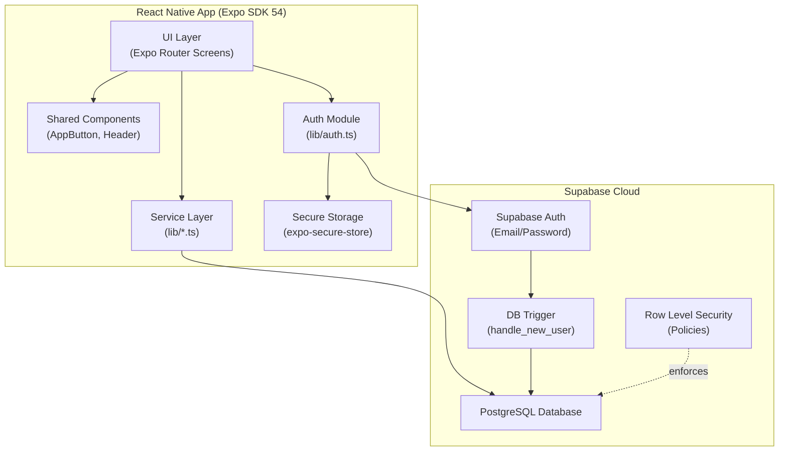
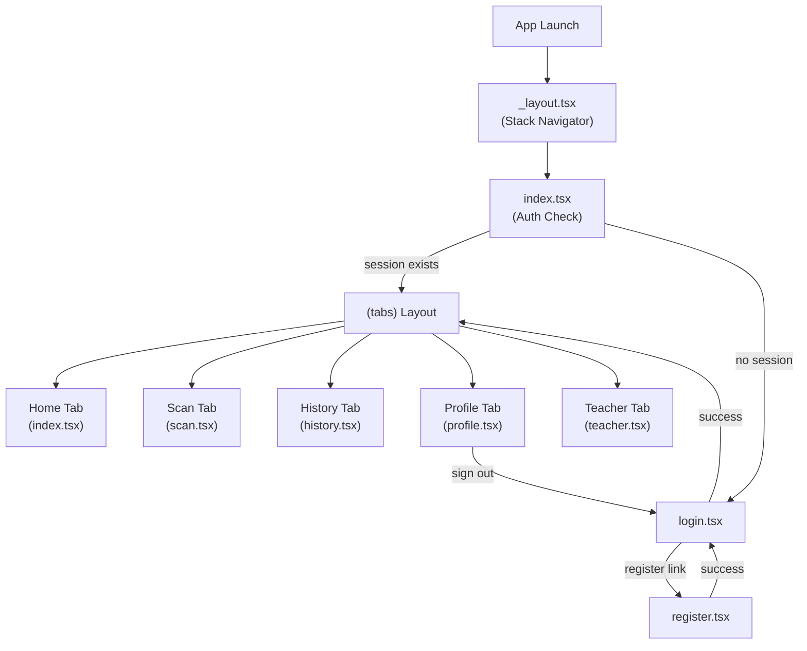
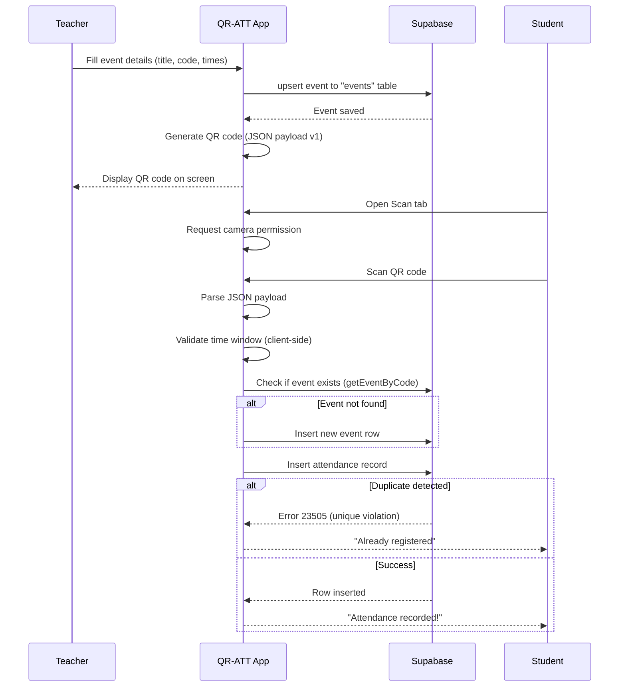
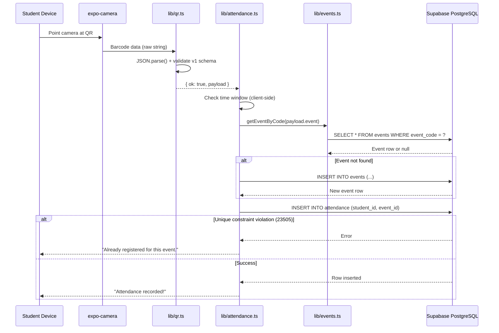

# PROJECT STATUS — QR-ATT (QR Attendance App)

> **Analysis Date:** October 12, 2026  
> **Analyst:** AI-assisted codebase inspection  
> **Repository:** `c:\Users\James Ivan\Desktop\QR-APP`  
> **Last Commit:** `3560d05 — Completed task in Midterm`

---

## A. Project Overview

| Field | Detail |
|---|---|
| **Application Name** | QR-ATT |
| **Package Name** | `qr-att` (npm), `com.xaconic.QRATT` (Android) |
| **Purpose** | Mobile application for recording school event attendance by scanning QR codes |
| **Problem Solved** | Replaces manual paper-based attendance tracking for school events with a digital QR code scanning system |
| **Intended Users** | Teachers (create events, generate QR codes, view attendance) and Students (scan QR codes, view personal attendance history) |
| **Current Status** | **Early-to-mid development** — core features are implemented with Supabase cloud backend, but several quality and completeness gaps remain |
| **Version** | 1.0.0 |
| **EAS Project ID** | `c3f34f28-2042-4a25-a9e7-b0c60900d18b` |
| **Owner** | `xaconic` |

### Main Technologies

| Category | Technology | Version |
|---|---|---|
| Framework | Expo (React Native) | SDK 54 (~54.0.35) |
| Language | TypeScript | ~5.9.2 |
| Runtime | React | 19.1.0 |
| Mobile | React Native | 0.81.5 |
| Routing | Expo Router | ~6.0.24 |
| Backend/Database | Supabase (PostgreSQL + Auth) | Client ^2.115.0 |
| Secure Storage | expo-secure-store | ~15.0.8 |
| Camera/QR Scanning | expo-camera | ~17.0.10 |
| QR Code Generation | react-native-qrcode-svg | ^6.3.21 |
| Date/Time Picker | @react-native-community/datetimepicker | 8.4.4 |

---

## B. Current Situation

### What Is Already Implemented

1. **Authentication System** — Full sign-up and sign-in flow using Supabase Auth with email/password. Session persistence across app restarts using `expo-secure-store` on native and `localStorage` on web. Global auth state management with a custom `useAuth` hook and listener pattern.

2. **Role-Based Registration** — Users choose "Student" or "Teacher" during registration. Role is stored in the `profiles` table in Supabase.

3. **Teacher Event Creation** — Teachers can create events with a title, event code, start/end time, and date/time picker. Quick-end time chips (+30min, +1hr, +2hr). Events are upserted to Supabase with `event_code` as the unique conflict key.

4. **QR Code Generation** — After creating an event, a QR code is rendered on-screen containing a JSON payload with event details (v1 protocol).

5. **QR Code Scanning** — Students use the device camera to scan QR codes. The scanned payload is parsed, validated for time window, and attendance is registered in Supabase.

6. **Attendance Recording** — Records are inserted into the `attendance` table with a unique constraint on `(student_id, event_id)` to prevent duplicates. Duplicate detection returns a friendly error message.

7. **Attendance History (Student)** — Students see a list of their scanned events with event title, code, and timestamp. Uses a Supabase join query on `attendance` → `events`.

8. **Attendance History (Teacher)** — Teachers see a summary of their events with attendee count per event.

9. **Profile Management** — Users can view their profile (name, email, role, user ID) and inline-edit their display name.

10. **Sign Out** — Clears local session and signs out from Supabase.

11. **Database Schema with RLS** — Full PostgreSQL schema with Row Level Security policies for `profiles`, `events`, and `attendance`. Includes a database trigger (`handle_new_user`) that auto-creates a profile row on user registration.

12. **Navigation** — Tab-based navigation (Home, Scan, History, Profile, Teacher) with Ionicons and route guards based on auth state.

13. **Dark Theme UI** — Consistent dark color scheme across all screens using a centralized `COLORS` constant.

### What Appears Functional (Based on Code Inspection)

- Login → Tab navigation redirect
- Registration with role selection → profile creation
- Event creation → QR code display
- QR scanning → attendance insertion with duplicate guard
- Session persistence across app restarts
- Role-based UI (Teacher tab locked for students)
- Profile name editing

### What Is Partially Implemented

1. **Auth Initialization** — `initializeAuth()` is defined in `lib/auth.ts` but is **never called** anywhere in the app. The root `_layout.tsx` does not invoke it. Session restoration on app start likely relies on Supabase's built-in session detection via `onAuthStateChange`, but the explicit initialization path is orphaned.

2. **Local Database (SQLite)** — `expo-sqlite` is listed as a dependency and configured as an Expo plugin, but **no SQLite code exists** in the application. The `lib/database.ts` file only contains type definitions that are duplicated in `lib/attendance.ts`. The migration from SQLite to Supabase (described in docs) appears complete, but the SQLite dependency was never removed.

3. **Event Time Validation** — Start/end time checks exist in `registerAttendance()` but only on the client side. There is no server-side validation of event time windows.

### What Is Unfinished or Missing

1. **No Test Suite** — Zero test files exist. No testing framework is installed. No `jest`, `vitest`, or any test runner in `package.json`.

2. **No Loading/Splash Flow** — The root `_layout.tsx` does not show a loading screen while determining auth state. On cold start, the app immediately redirects based on the synchronous (initially null) session state, which will flash the login screen before redirecting authenticated users.

3. **Hardcoded Student ID Constant** — `constants/student.ts` exports `STUDENT_ID = 'STUDENT-2026-001'`, a leftover from the pre-auth era. This constant is **not imported anywhere** in the current codebase but has not been cleaned up.

4. **Duplicate Profile Service Files** — Both `lib/profile.ts` and `lib/profiles.ts` exist with **identical** code. The app imports from `lib/profiles.ts` (used by `history.tsx`, `profile.tsx`, `teacher.tsx`). `lib/profile.ts` is orphaned.

5. **Teacher Tab Visibility** — The Teacher tab appears in the bottom navigation for **all users** (students and teachers alike). Students see a "Teachers Only" lock screen when they tap it, but the tab icon is always visible — poor UX.

6. **No Email Verification Enforcement** — Supabase email confirmation is mentioned in the registration flow's success message, but the app does not actually check whether a user's email is verified before allowing login.

7. **Missing `initializeAuth()` Call** — The auth module exports `initializeAuth()` which sets up session recovery and auth state listener, but the root layout never calls it.

8. **No Event Deletion** — Teachers cannot delete or edit existing events.

9. **No Attendance Export** — No way to export or share attendance data.

10. **No Pull-to-Refresh** — History and profile screens have no refresh mechanism other than tab refocusing.

### Technical Limitations

- **Client-only validation** — All business logic (time window checks, role checks) runs on the client. A modified client could bypass these checks.
- **No rate limiting** — No protection against rapid duplicate scan attempts beyond the database unique constraint.
- **Events can be created by any authenticated user** — The RLS policy for event insertion checks `auth.uid() = created_by` but does not verify the user's role is `teacher`. A student could create events via the Supabase API directly.

---

## C. Complete Project Structure

```
QR-APP/
├── app/                          # Expo Router pages (file-based routing)
│   ├── _layout.tsx               # Root Stack navigator (no headers)
│   ├── index.tsx                 # Entry redirect: session → tabs, else → login
│   ├── login.tsx                 # Email/password sign-in screen
│   ├── register.tsx              # Registration screen with role selector
│   ├── +not-found.tsx            # 404 fallback screen
│   └── (tabs)/                   # Tab navigator group
│       ├── _layout.tsx           # Tab bar configuration (5 tabs)
│       ├── index.tsx             # Home tab — welcome + quick-action buttons
│       ├── scan.tsx              # QR Scanner tab — camera + attendance registration
│       ├── history.tsx           # History tab — role-aware attendance list
│       ├── profile.tsx           # Profile tab — user info + name editing + sign out
│       └── teacher.tsx           # Teacher tab — event creation + QR generation
│
├── lib/                          # Service/business logic layer
│   ├── supabase.ts               # Supabase client initialization (platform-aware storage)
│   ├── auth.ts                   # Auth functions: signIn, signUp, signOut, useAuth hook
│   ├── attendance.ts             # Attendance CRUD, QR scan handler, teacher summaries
│   ├── events.ts                 # Event CRUD: create, getByTeacher, getByCode
│   ├── profiles.ts               # Profile CRUD: getProfile, updateProfile (ACTIVE)
│   ├── profile.ts                # Profile CRUD: getProfile, updateProfile (DUPLICATE — unused)
│   ├── database.ts               # Type definitions only (orphaned from SQLite era)
│   └── qr.ts                    # QR payload builder and parser (v1 JSON format)
│
├── components/                   # Shared UI components
│   ├── AppButton.tsx             # Styled button with primary/secondary themes + icon
│   └── Header.tsx                # App header with QR scanner icon + title
│
├── constants/                    # App-wide constants
│   ├── colors.ts                 # COLORS object — dark theme palette
│   ├── student.ts                # Hardcoded STUDENT_ID (legacy, unused)
│   └── mycolor.md                # Color reference doc (older version of colors.ts)
│
├── supabase/
│   └── schema.sql                # Full database schema: tables, RLS policies, trigger
│
├── docs/                         # Teaching/planning documentation (12 files, 00–11)
│   ├── 00-current-architecture.md
│   ├── 01-project-setup.md
│   ├── 02-authentication.md
│   ├── 03-database-design.md
│   ├── 04-database-service.md
│   ├── 05-profiles.md
│   ├── 06-attendance-by-role.md
│   ├── 07-visual-identity.md
│   ├── 08-events.md
│   ├── 09-qr-generation.md
│   ├── 10-qr-attendance.md
│   └── 11-attendance-history.md
│
├── assets/                       # Images, icons, splash screens
│   ├── images/
│   │   ├── jip.png               # App icon (used for splash + Android icon)
│   │   ├── android-icon-*.png    # Adaptive icon layers
│   │   ├── favicon.png           # Web favicon
│   │   ├── splash-icon.png       # Splash screen icon
│   │   └── tabIcons/             # Custom tab bar icons (home, explore)
│   └── expo.icon/                # Expo icon assets
│
├── android/                      # Generated Android native project (prebuild)
├── .env                          # Environment variables (Supabase URL + anon key)
├── .gitignore                    # Git ignore rules
├── app.json                      # Expo configuration
├── eas.json                      # EAS Build configuration (dev, preview, production)
├── package.json                  # npm dependencies and scripts
├── tsconfig.json                 # TypeScript configuration
├── README.md                     # Setup instructions for first-time developers
├── android_emulator.md           # Android emulator launch guide
└── icon.jpg                      # Source icon file
```

### Key File Relationships

| File | Depends On | Used By |
|---|---|---|
| `lib/supabase.ts` | `@supabase/supabase-js`, `expo-secure-store` | All `lib/*.ts` files |
| `lib/auth.ts` | `lib/supabase.ts` | `app/index.tsx`, `app/login.tsx`, `app/register.tsx`, all tab screens |
| `lib/profiles.ts` | `lib/supabase.ts` | `app/(tabs)/profile.tsx`, `app/(tabs)/history.tsx`, `app/(tabs)/teacher.tsx` |
| `lib/events.ts` | `lib/supabase.ts` | `app/(tabs)/teacher.tsx`, `lib/attendance.ts` |
| `lib/attendance.ts` | `lib/supabase.ts`, `lib/qr.ts`, `lib/events.ts` | `app/(tabs)/scan.tsx`, `app/(tabs)/history.tsx` |
| `lib/qr.ts` | (none) | `lib/attendance.ts`, `app/(tabs)/teacher.tsx` |
| `components/AppButton.tsx` | `constants/colors.ts` | All screen files |
| `components/Header.tsx` | `constants/colors.ts` | `app/login.tsx`, `app/register.tsx`, `app/(tabs)/index.tsx` |

---

## D. Application Architecture

### High-Level Architecture



### Navigation Flow



### QR Attendance Flow



---

## E. Existing Features and Implementation Status

| Feature | Location in Code | Current Implementation | Status | Notes |
|---|---|---|---|---|
| Email/Password Login | `app/login.tsx`, `lib/auth.ts` → `signIn()` | Supabase `signInWithPassword`, session stored in secure storage | **Implemented** | Includes error display and loading state |
| Email/Password Registration | `app/register.tsx`, `lib/auth.ts` → `signUp()` | Supabase `signUp` + profile update with name/role | **Implemented** | Email confirmation mentioned in UI but not enforced |
| Session Persistence | `lib/supabase.ts`, `lib/auth.ts` | `expo-secure-store` on native, `localStorage` on web | **Partially Implemented** | `initializeAuth()` exists but is never called; relies on `onAuthStateChange` implicitly |
| Role Selection (Student/Teacher) | `app/register.tsx` | Chip-based toggle, stored in `profiles.role` | **Implemented** | — |
| Auth-Based Route Guard | `app/index.tsx` | Redirects based on `session` presence | **Partially Implemented** | No loading state — may flash login screen on cold start |
| Tab Navigation | `app/(tabs)/_layout.tsx` | 5 tabs: Home, Scan, History, Profile, Teacher | **Implemented** | Teacher tab visible to all users |
| Home Screen | `app/(tabs)/index.tsx` | Welcome text + navigation buttons | **Implemented** | Static — no dynamic data |
| QR Code Scanning | `app/(tabs)/scan.tsx` | `expo-camera` CameraView with barcode scanning | **Implemented** | Requests camera permission, handles scan results |
| QR Payload Protocol | `lib/qr.ts` | JSON v1 format: `{v, event, title?, start?, end?}` | **Implemented** | Build and parse functions with validation |
| Attendance Registration | `lib/attendance.ts` → `registerAttendance()` | Parse QR → validate time → find/create event → insert attendance | **Implemented** | Duplicate detection via PostgreSQL unique constraint |
| Event Time Window Validation | `lib/attendance.ts` L170–L180 | Client-side `Date.now()` vs start/end comparison | **Implemented** | Client-only — no server-side enforcement |
| Event Creation (Teacher) | `app/(tabs)/teacher.tsx`, `lib/events.ts` → `createEvent()` | Form with title, code, date pickers, upsert to Supabase | **Implemented** | Input sanitization applied |
| QR Code Display | `app/(tabs)/teacher.tsx` L264–L274 | `react-native-qrcode-svg` renders payload after event creation | **Implemented** | — |
| Student Attendance History | `app/(tabs)/history.tsx`, `lib/attendance.ts` → `getAttendanceHistory()` | FlatList of attendance records with joined event data | **Implemented** | Sorted by `scanned_at` descending |
| Teacher Attendance Summary | `app/(tabs)/history.tsx`, `lib/attendance.ts` → `getTeacherEventSummary()` | Summary cards showing attendee count per event | **Implemented** | No drill-down into individual attendees |
| Profile View | `app/(tabs)/profile.tsx` | Displays name, role badge, email, user ID | **Implemented** | — |
| Profile Name Editing | `app/(tabs)/profile.tsx` | Inline edit with save button → `updateProfile()` | **Implemented** | — |
| Sign Out | `app/(tabs)/profile.tsx`, `lib/auth.ts` → `signOut()` | Clears local session, calls `supabase.auth.signOut()` | **Implemented** | Redirects to login |
| Teacher Tab Role Gate | `app/(tabs)/teacher.tsx` L108–L116 | Checks profile role, shows lock screen for non-teachers | **Implemented** | Tab icon still visible to students |
| Database Schema (RLS) | `supabase/schema.sql` | 3 tables, 7 RLS policies, 1 trigger | **Implemented** | Schema appears production-ready |
| Dark Theme | `constants/colors.ts` | Consistent dark palette used across all screens | **Implemented** | — |
| AppButton Component | `components/AppButton.tsx` | Primary/secondary button with Ionicon + disabled state | **Implemented** | — |
| Header Component | `components/Header.tsx` | QR scanner icon in circle + title text | **Implemented** | — |
| Android Build Config | `app.json`, `eas.json` | Adaptive icon, edge-to-edge, EAS build profiles | **Implemented** | Dev, preview, and production profiles configured |
| Email Verification | `app/register.tsx` L100–L104 | Success message mentions checking email | **Not Implemented** | UI suggests it exists, but login does not check `email_confirmed_at` |
| Event Editing/Deletion | — | — | **Not Implemented** | No UI or service function exists |
| Attendance Export | — | — | **Not Implemented** | No export/share functionality |
| Teacher Attendee Drill-Down | `lib/attendance.ts` → `getTeacherEventAttendance()` | Service function exists with full attendee list | **Partially Implemented** | Backend query exists but no UI renders individual attendees |
| Pull-to-Refresh | — | — | **Not Implemented** | Lists rely on `useFocusEffect` only |
| Tests | — | — | **Not Implemented** | No test files or test framework |
| Offline Support | — | — | **Not Implemented** | App requires network connectivity |

---

## F. Database and Data Flow

### Database Technology

**Supabase (hosted PostgreSQL)** accessed via `@supabase/supabase-js` client library.

> **Note:** `expo-sqlite` is listed as a dependency and Expo plugin, but **no SQLite code exists** in the codebase. The `docs/00-current-architecture.md` confirms this was the original local database, now replaced by Supabase.

### Tables

#### `profiles`
| Column | Type | Constraints | Description |
|---|---|---|---|
| `id` | `uuid` | PK, FK → `auth.users(id)` ON DELETE CASCADE | Supabase user ID |
| `email` | `text` | NOT NULL | User's email address |
| `full_name` | `text` | nullable | Display name |
| `role` | `text` | NOT NULL, DEFAULT `'student'`, CHECK (`student` or `teacher`) | User role |
| `created_at` | `timestamptz` | NOT NULL, DEFAULT `now()` | Account creation timestamp |
| `updated_at` | `timestamptz` | NOT NULL, DEFAULT `now()` | Last update timestamp |

#### `events`
| Column | Type | Constraints | Description |
|---|---|---|---|
| `id` | `uuid` | PK, DEFAULT `gen_random_uuid()` | Auto-generated event ID |
| `event_code` | `text` | NOT NULL, UNIQUE | Teacher-assigned event identifier (e.g., `EVT-2026-0002`) |
| `title` | `text` | NOT NULL | Event display name |
| `start_time` | `timestamptz` | nullable | Event start time |
| `end_time` | `timestamptz` | nullable | Event end time |
| `created_by` | `uuid` | FK → `auth.users(id)` ON DELETE SET NULL | Teacher who created the event |
| `created_at` | `timestamptz` | NOT NULL, DEFAULT `now()` | Row creation timestamp |

#### `attendance`
| Column | Type | Constraints | Description |
|---|---|---|---|
| `id` | `uuid` | PK, DEFAULT `gen_random_uuid()` | Auto-generated record ID |
| `student_id` | `uuid` | NOT NULL, FK → `auth.users(id)` ON DELETE CASCADE | Student who scanned |
| `event_id` | `uuid` | NOT NULL, FK → `events(id)` ON DELETE CASCADE | Associated event |
| `scanned_at` | `timestamptz` | NOT NULL, DEFAULT `now()` | Timestamp of scan |
| — | — | UNIQUE (`student_id`, `event_id`) | Prevents duplicate attendance |

### Row Level Security Policies

| Table | Policy | Action | Rule |
|---|---|---|---|
| `profiles` | Profiles are viewable by owner | SELECT | `auth.uid() = id` |
| `profiles` | Users can insert their own profile | INSERT | `auth.uid() = id` |
| `profiles` | Users can update their own profile | UPDATE | `auth.uid() = id` (both USING and WITH CHECK) |
| `events` | Events are readable by any authenticated user | SELECT | `true` (any authenticated user) |
| `events` | Users can insert events | INSERT | `auth.uid() = created_by` |
| `events` | Users can update their own events | UPDATE | `auth.uid() = created_by` |
| `attendance` | Students can view their own attendance | SELECT | `auth.uid() = student_id` |
| `attendance` | Students can insert their own attendance | INSERT | `auth.uid() = student_id` |
| `attendance` | Teachers can view attendance for their events | SELECT | Subquery: event's `created_by = auth.uid()` |

### Database Trigger

```sql
-- Automatically creates a profile row when a new user signs up
CREATE TRIGGER on_auth_user_created
  AFTER INSERT ON auth.users
  FOR EACH ROW EXECUTE PROCEDURE public.handle_new_user();
```

The trigger inserts `(id, email)` into `profiles` with `ON CONFLICT DO NOTHING`.

### Typical Data Flow: Student Scanning QR Code



---

## G. Configuration and Dependencies

### Runtime Requirements

| Requirement | Details |
|---|---|
| Node.js | LTS (specific version not pinned; tested with Node 18+) |
| npm | Comes with Node.js |
| Expo CLI | Via `npx expo` (no global install required) |
| Expo Go | Version 54.0.8 (for testing on physical devices) |
| Android SDK | Required for `expo run:android` (emulator guide provided) |

### Key Dependencies

| Package | Purpose |
|---|---|
| `expo` (~54.0.35) | Framework and build system |
| `expo-router` (~6.0.24) | File-based routing |
| `@supabase/supabase-js` (^2.115.0) | Supabase client for auth + database |
| `expo-camera` (~17.0.10) | Camera access for QR scanning |
| `expo-secure-store` (~15.0.8) | Encrypted key-value storage for auth tokens |
| `react-native-qrcode-svg` (^6.3.21) | QR code image generation |
| `react-native-svg` (15.12.1) | SVG rendering (required by qrcode-svg) |
| `@react-native-community/datetimepicker` (8.4.4) | Native date/time picker for event creation |
| `@expo/vector-icons` (^15.0.3) | Ionicons and MaterialIcons |
| `react-native-safe-area-context` (~5.6.0) | Safe area inset handling |
| `expo-sqlite` (~16.0.10) | **UNUSED** — leftover from pre-Supabase migration |
| `react-native-worklets` (0.5.1) | Required by react-native-reanimated |
| `expo-dev-client` (~6.0.21) | Development build support |

### Configuration Files

| File | Purpose |
|---|---|
| `app.json` | Expo app configuration (name, icons, plugins, EAS project) |
| `eas.json` | EAS Build profiles (development, preview, production) |
| `tsconfig.json` | TypeScript config with strict mode + `@/*` path alias |
| `package.json` | Dependencies, scripts, app metadata |
| `.env` | Supabase credentials (not committed to git) |
| `.gitignore` | Ignores `node_modules`, `.expo`, `.env`, `docs/` |

### Required Environment Variables

| Variable | Purpose | Required |
|---|---|---|
| `EXPO_PUBLIC_SUPABASE_URL` | Supabase project URL (e.g., `https://xxxxx.supabase.co`) | **Yes** |
| `EXPO_PUBLIC_SUPABASE_ANON_KEY` | Supabase anonymous/public API key | **Yes** |

> The app will start without these variables but auth and database features will not function. A console warning is emitted.

### npm Scripts

| Script | Command |
|---|---|
| `start` | `expo start` |
| `android` | `expo run:android` |
| `ios` | `expo run:ios` |
| `web` | `expo start --web` |

---

## H. How to Run the Application

### Prerequisites

1. **Node.js LTS** (v18+) — [https://nodejs.org](https://nodejs.org)
2. **Expo Go** app (v54.0.8) on a physical device — from Play Store or App Store
3. **Supabase Project** — with the schema from `supabase/schema.sql` applied
4. (Optional) **Android SDK + Emulator** — for `expo run:android` (see `android_emulator.md`)

### Setup Steps

```powershell
# 1. Clone/navigate to the project
cd "C:\Users\James Ivan\Desktop\QR-APP"

# 2. Install dependencies
npm install --legacy-peer-deps

# 3. Create .env file with your Supabase credentials
# Create a file named .env in the project root with:
#   EXPO_PUBLIC_SUPABASE_URL=https://your-project.supabase.co
#   EXPO_PUBLIC_SUPABASE_ANON_KEY=your-anon-key-here

# 4. Apply the database schema in Supabase
# Go to your Supabase dashboard → SQL Editor → paste contents of supabase/schema.sql → Run

# 5. Start the development server
npx expo start

# 6. Scan the QR code with Expo Go, or press 'w' for web, or 'a' for Android emulator
```

### Available Commands

| Command | Description | Verified |
|---|---|---|
| `npx expo start` | Start Metro bundler with QR code for Expo Go | ⚠️ Not verified in this analysis |
| `npx expo start --web` | Start in web browser | ⚠️ Not verified |
| `npx expo run:android` | Build and run on Android (requires SDK) | ⚠️ Not verified |
| `npx tsc --noEmit` | Type-check without emitting files | ⚠️ Not verified |

### Common Problems

| Problem | Solution |
|---|---|
| `npm install` fails | Use `npm install --legacy-peer-deps` |
| App crashes in Expo Go | Ensure all package versions match Expo SDK 54 |
| QR code won't scan in Expo Go | Phone and computer must be on the same WiFi network |
| White screen on launch | Wait 10 seconds, or shake device → Reload |
| Supabase errors | Verify `.env` variables are correct and schema is applied |
| Auth not persisting | Ensure `expo-secure-store` is configured (check `app.json` plugins) |

---

## I. Known Issues and Technical Debt

### Confirmed Issues

| # | Issue | Location | Impact | Suggested Resolution |
|---|---|---|---|---|
| 1 | **`initializeAuth()` never called** | `lib/auth.ts` L27–L41 defined, never invoked | Session recovery on cold start may be unreliable; depends on implicit Supabase behavior | Call `initializeAuth()` in root `_layout.tsx` inside a `useEffect` |
| 2 | **Duplicate profile service files** | `lib/profile.ts` and `lib/profiles.ts` — identical code | Confusion for developers; risk of editing the wrong file | Delete `lib/profile.ts` (the unused one) |
| 3 | **Orphaned `database.ts`** | `lib/database.ts` — only type exports, duplicated in `attendance.ts` | Dead code; misleading file name suggests active database logic | Delete `lib/database.ts` |
| 4 | **Unused `student.ts` constant** | `constants/student.ts` — `STUDENT_ID` not imported anywhere | Dead code from pre-auth era | Delete `constants/student.ts` |
| 5 | **Unused `expo-sqlite` dependency** | `package.json` L28, `app.json` L40 | Increases bundle size unnecessarily; leftover from migration | Remove `expo-sqlite` from dependencies and plugins |
| 6 | **`mycolor.md` in constants** | `constants/mycolor.md` — `.md` file containing TypeScript code | Misleading file extension; appears to be an earlier version of `colors.ts` | Delete `constants/mycolor.md` |
| 7 | **Double semicolon** | `lib/attendance.ts` L3: `import { getEventByCode } from './events';;` | Syntax lint issue (harmless but untidy) | Remove extra semicolon |
| 8 | **Unused `shortId` function** | `app/(tabs)/history.tsx` L118–L120 — defined but never called | Dead code | Remove `shortId` function |
| 9 | **Hardcoded dark tab bar colors** | `app/(tabs)/_layout.tsx` L9, L13 — uses `'#25292e'` and `'#ffd33d'` instead of `COLORS` constants | Inconsistent with the rest of the app's theme system | Use `COLORS.background`, `COLORS.primary`, etc. |
| 10 | **Hardcoded dark background in +not-found** | `app/+not-found.tsx` L18 — `backgroundColor: '#25292e'` | Inconsistent theming | Use `COLORS.background` |
| 11 | **No auth loading state in root** | `app/_layout.tsx` | Users see a brief login screen flash before being redirected to tabs on cold start | Add a splash/loading screen while `useAuth().loading` is true |
| 12 | **Teacher tab visible to students** | `app/(tabs)/_layout.tsx` L69–L81 | Confusing UX — students see a locked tab they can never access | Conditionally hide the Teacher tab based on user role |

### Security Concerns

| # | Concern | Location | Impact | Suggested Resolution |
|---|---|---|---|---|
| S1 | **No role check on event creation (RLS)** | `supabase/schema.sql` L54–L58 | Any authenticated user (including students) can insert events via the Supabase API directly | Add a `role = 'teacher'` check in the RLS policy or use a Supabase Edge Function |
| S2 | **Client-side time validation only** | `lib/attendance.ts` L170–L180 | A modified client can bypass event time window checks | Add server-side validation via RLS policy or database function |
| S3 | **No email verification enforcement** | `lib/auth.ts`, `app/login.tsx` | Users can sign in without verifying their email | Check `user.email_confirmed_at` before allowing access |
| S4 | **Supabase anon key in client** | `lib/supabase.ts` L31 | Expected for Supabase architecture (public key), but all security relies on RLS being correctly configured | Ensure all RLS policies are thorough; consider Edge Functions for sensitive operations |

### Maintainability Issues

| # | Issue | Location | Impact |
|---|---|---|---|
| M1 | Extensive use of `any` type in Supabase query callbacks | `lib/attendance.ts`, `lib/events.ts` | Reduces type safety; hides potential data shape mismatches |
| M2 | No centralized error handling | All service files | Each screen handles errors independently with inconsistent patterns |
| M3 | No environment validation beyond console warning | `lib/supabase.ts` L33–L35 | App silently fails with unhelpful errors when `.env` is misconfigured |

---

## J. Remaining Work and Priorities

### Critical

| # | Item | Expected Outcome | Reason |
|---|---|---|---|
| C1 | **Call `initializeAuth()` on app startup** | Reliable session recovery on cold start | Currently the auth initialization code exists but is never executed, potentially causing inconsistent auth state |
| C2 | **Add role-based RLS for event creation** | Only teachers can create events at the database level | Current policy allows any authenticated user to insert events |

### High

| # | Item | Expected Outcome | Reason |
|---|---|---|---|
| H1 | **Add loading/splash screen during auth check** | No login screen flash for authenticated users on cold start | Current behavior is jarring and confusing |
| H2 | **Hide Teacher tab for student users** | Clean navigation — students only see relevant tabs | Students currently see a locked tab they cannot use |
| H3 | **Remove unused dependencies** | Smaller bundle, less confusion (`expo-sqlite`, dead files) | Leftover artifacts from migration |
| H4 | **Add email verification check** | Only verified users can access the app | Currently any registered email can immediately sign in |
| H5 | **Teacher attendee drill-down UI** | Teachers can see which students attended each event | Backend function `getTeacherEventAttendance()` exists but no UI renders the attendee list |

### Medium

| # | Item | Expected Outcome | Reason |
|---|---|---|---|
| M1 | **Add pull-to-refresh on History and Profile** | Users can manually refresh data without switching tabs | Currently data only refreshes on tab focus |
| M2 | **Add event editing and deletion** | Teachers can manage their events after creation | No CRUD beyond create exists |
| M3 | **Server-side time window validation** | Prevent attendance registration outside event hours even from modified clients | Currently validation is client-only |
| M4 | **Add Supabase type generation** | Full type safety for database queries | Currently uses `any` casts on query results |
| M5 | **Standardize color usage in tab layout and 404 page** | Consistent theming across entire app | Hardcoded hex values bypass the `COLORS` system |
| M6 | **Add error boundaries** | Graceful error recovery instead of white screens | No error boundaries exist |

### Low

| # | Item | Expected Outcome | Reason |
|---|---|---|---|
| L1 | **Delete orphaned files** | Cleaner codebase (`lib/profile.ts`, `lib/database.ts`, `constants/student.ts`, `constants/mycolor.md`) | Dead code creates confusion |
| L2 | **Add attendance export** | Teachers can download attendance as CSV/PDF | Useful feature for administrative purposes |
| L3 | **Add testing framework and basic tests** | Confidence in code correctness | Zero tests exist |
| L4 | **Add offline caching** | App works without network connectivity | Currently requires internet for all features |
| L5 | **Fix minor code issues** | Clean codebase (double semicolons, unused functions) | Code hygiene |
| L6 | **Update `updated_at` on profile changes** | `profiles.updated_at` reflects actual last-modified time | Currently `updated_at` is only set to `now()` on row creation and is never updated by the app |

---

## K. Testing and Verification

### Existing Tests

**None.** No test files, test framework, or testing dependencies exist in the project.

### Available Validation Commands

| Command | Purpose | Status |
|---|---|---|
| `npx tsc --noEmit` | TypeScript type checking | ⚠️ Not executed during this analysis |
| — | Unit tests | ❌ No test framework installed |
| — | Integration tests | ❌ Not available |
| — | E2E tests | ❌ Not available |

### Analysis Methodology

This documentation was produced through **static code analysis only**:

- All source files were read and cross-referenced.
- Import/export chains were traced to identify used vs. unused code.
- Database schema was compared against service layer queries.
- Navigation flow was traced through Expo Router file structure.
- Auth flow was traced from login → session storage → redirect logic.
- RLS policies were analyzed for completeness.

**Limitations of this analysis:**
- The application was **not started** or **executed** during this inspection.
- No Supabase connection was tested.
- No runtime behavior was observed.
- Type-check results were not obtained.
- All "Implemented" statuses are based on code presence, not runtime verification.

### Areas That Remain Untested

- Actual login/registration flow against Supabase
- Camera QR scanning on a real device
- RLS policy enforcement in practice
- Session persistence across app restarts
- Date/time picker behavior on iOS vs. Android
- Edge cases (network errors, expired sessions, malformed QR codes)

---

## L. Overall Assessment

### Current Maturity

**QR-ATT is a functional early-stage application** that has successfully migrated from a local SQLite-based system to a cloud-based Supabase architecture. The core feature set — authentication, event creation, QR generation, QR scanning, attendance recording, and history viewing — is implemented end-to-end with a consistent dark-themed UI.

### What Is Already In Place

- ✅ Complete authentication flow (sign up, sign in, sign out, session persistence)
- ✅ Role-based user system (student vs. teacher)
- ✅ Full database schema with Row Level Security
- ✅ Event creation with QR code generation
- ✅ QR code scanning with attendance registration
- ✅ Attendance history for both students and teachers
- ✅ Profile management with inline editing
- ✅ Consistent dark theme design system
- ✅ 12 planning/architecture documents in `docs/`

### What Is Preventing Completion

1. **Auth initialization gap** — `initializeAuth()` is never called, making cold-start auth behavior unreliable.
2. **No tests** — Zero automated validation exists for any feature.
3. **Dead code from migration** — SQLite dependency, duplicate files, and orphaned constants remain.
4. **RLS security gap** — Any authenticated user can create events (no teacher role check at database level).
5. **UX issues** — Login flash on cold start, Teacher tab visible to students.

### Top 5 Next Steps (Recommended)

1. **Fix auth initialization** — Call `initializeAuth()` in the root layout and add a loading screen. This is the most impactful single change for user experience reliability.

2. **Clean up dead code** — Remove `expo-sqlite`, `lib/profile.ts`, `lib/database.ts`, `constants/student.ts`, `constants/mycolor.md`, and the unused `shortId` function. This reduces confusion for any developer working on the codebase.

3. **Add teacher role check to event creation RLS** — Prevent students from creating events at the database level. This closes the most significant security gap.

4. **Hide Teacher tab for students** — Use the profile role to conditionally render tabs. This is a small change with significant UX improvement.

5. **Add basic tests** — Install a test framework and write tests for `lib/qr.ts` (pure functions, easy to test) and `lib/auth.ts` as a starting point.

## Implementation Addendum — October 13, 2026

The later FINALS documents now describe the implemented application rather than only the original audit. The historical inspection below is retained unchanged. Current implementation summaries are in `administrator_role.md`, `administrator_profile.md`, `event_status.md`, `edit_event.md`, `home_event_discovery.md`, `qr_image_upload.md`, `qr_download_sharing.md`, and `features_added.md`.

Current verification: `npx tsc --noEmit` and `npx expo export --platform web` passed. Native gallery saving requires a development/standalone build; Expo Go uses the share-sheet fallback. Live Supabase migration/RLS checks and full native emulator verification remain environment-dependent.

### Verification Before Declaring Complete

Before considering this application production-ready, the following should be verified:

- [ ] `npx tsc --noEmit` passes with zero errors
- [ ] Login/registration works against a live Supabase instance
- [ ] QR scanning works on at least one physical Android device
- [ ] Session persists across app kill and relaunch
- [ ] RLS policies correctly restrict data access (test with multiple user accounts)
- [ ] Teacher tab is invisible to student accounts
- [ ] Duplicate attendance is correctly prevented
- [ ] Event time window validation works correctly
- [ ] App gracefully handles network errors
- [ ] All dead code and unused dependencies are removed

---

*This document was generated through static analysis of the codebase on October 12, 2026. No application code was modified during this inspection. All findings are based on reading source files, configuration, and documentation — not on runtime execution.*
